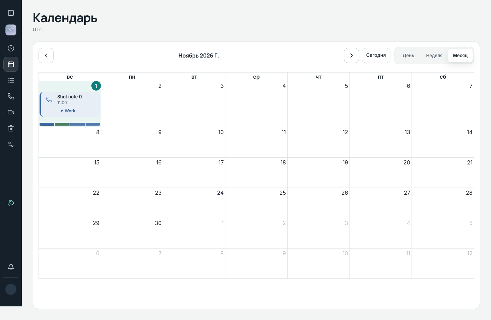
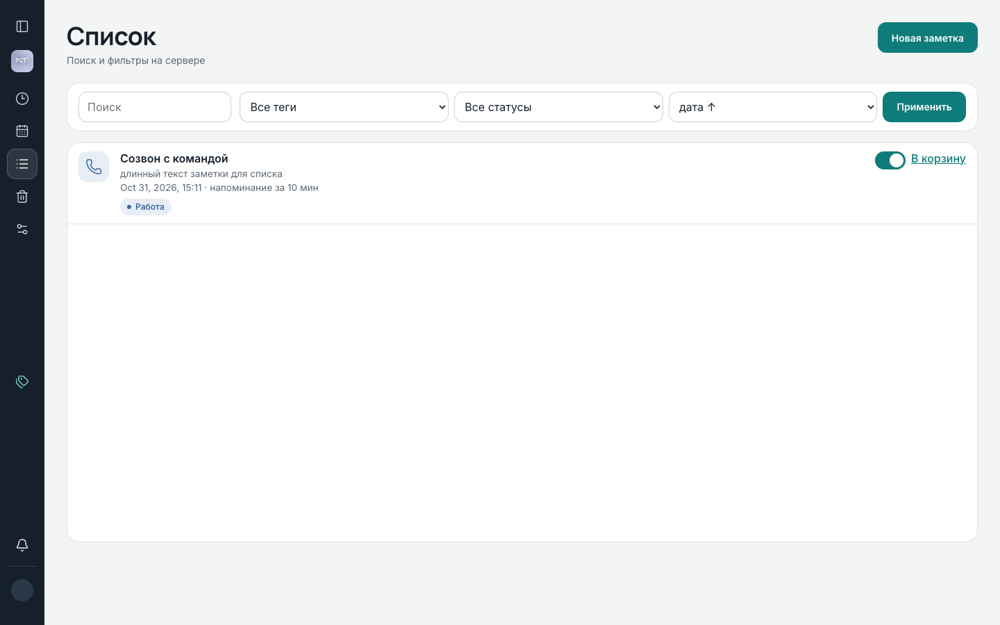
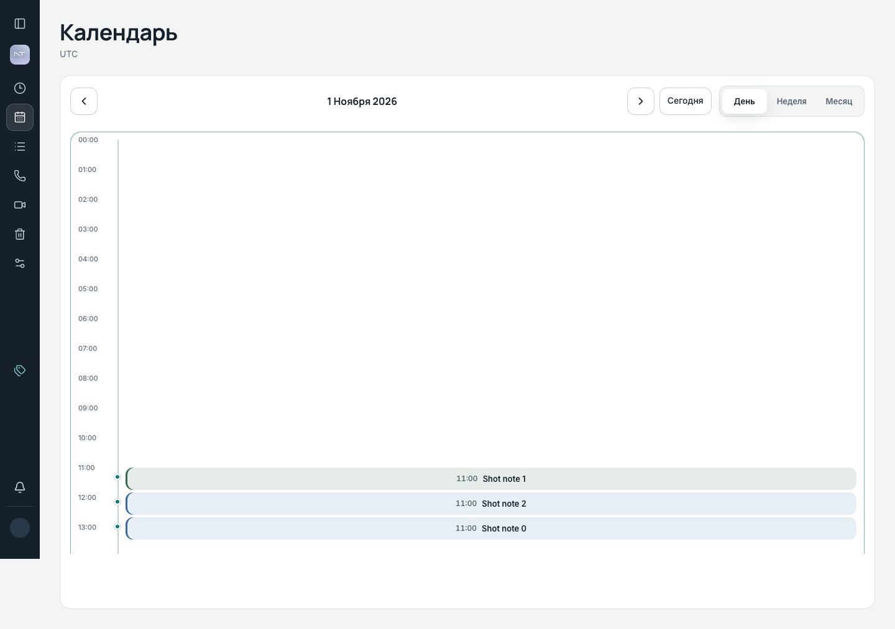

# Notetaker

Клиент-серверные заметки, привязанные к дате и времени: календарь, теги, повторы, напоминания (email + in-app), совместный доступ, вложения, разбор звонков и YouTube-субтитров, live-синхронизация между вкладками.

Полные требования — [`spec.md`](spec.md). Текущее состояние — [`STATUS.md`](STATUS.md).

## Основные возможности

- **Заметки и теги** — создание, поиск и фильтры на сервере, корзина с автоочисткой через 30 дней
- **Календарь и «Ближайшее»** — месяц / неделя / день, drag-and-drop, повторы (daily/weekly/monthly)
- **Напоминания** — email (MailHog локально) и in-app toast; состояние в БД, переживает рестарт
- **Realtime** — WebSocket + `pg_notify`; правки и уведомления без перезагрузки
- **Общие заметки** — владелец делится по логину; участник редактирует, не удаляет
- **Вложения** — файлы до 10 МБ, превью, autosave черновика
- **Звонки и видео** — импорт транскрипта / Web Speech; субтитры YouTube → ИИ-конспект (stub или OpenRouter)
- **Офлайн** — очередь create/PATCH в IndexedDB, идемпотентный create

## Скриншоты

| Календарь (месяц) | Список | День |
|---|---|---|
|  |  |  |

Больше экранов (в т.ч. mobile 390) — в [`docs/design/screens/`](docs/design/screens/).

## Технологический стек

| Слой | Технологии |
|---|---|
| Frontend | React 18, TypeScript, Vite, TanStack Query / Virtual, FullCalendar 6, luxon |
| Backend | Python 3.12, FastAPI, SQLAlchemy 2 (async), Alembic, argon2 |
| Database | PostgreSQL 16 (`SKIP LOCKED`, `LISTEN/NOTIFY`, `pg_trgm`) |
| Background jobs | DB-poll воркер (reminders, email outbox, materializer, trash purge) |
| Realtime | `pg_notify` → API LISTEN → WebSocket |
| Mail (dev) | MailHog |
| Testing | pytest + testcontainers; Playwright |
| Infrastructure | Docker Compose (`postgres`, `api`, `worker`, `web`, `mailhog`) |

## Архитектура и документация

```
Browser ──HTTP/WS──▶ api (FastAPI) ──SQL──▶ PostgreSQL
                         │ LISTEN              ▲
                         │ pg_notify ◀─────────┤
worker (reminders/outbox/purge) ───────────────┘
                         └── SMTP ──▶ MailHog
```

| Документ | Содержание |
|---|---|
| [`spec.md`](spec.md) | требования, схема, API, этапы M0–M25 |
| [`STATUS.md`](STATUS.md) | что работает / не работает / дальше |
| [`docs/HISTORY.md`](docs/HISTORY.md) | подробные смоки прошлых этапов |
| [`docs/DECISIONS.md`](docs/DECISIONS.md) | лог решений (D-NNN) |
| [`docs/FRONTEND.md`](docs/FRONTEND.md) | UI: токены, экраны, правила |
| [`docs/TESTING.md`](docs/TESTING.md) | pytest, e2e, verify, команды без make |
| [`docs/TOOLING.md`](docs/TOOLING.md) | чем собирали проект |
| [`docs/CREDITS.md`](docs/CREDITS.md) | зависимости и ассеты |
| [`docs/sessions/`](docs/sessions/) | экспорты чатов Cursor |

## Требования для запуска

Проект **не** устанавливает Docker и Git за вас.

| Для запуска UI/API | Для тестов (`make test` / `e2e` / `verify`) |
|---|---|
| Git | Python 3.11+ (лучше 3.12) |
| Docker 24+ и Compose v2 | Node.js 20+ и npm |
| curl (или PowerShell) для health | `make` (Unix/WSL2) |

**macOS / Windows:** [Docker Desktop](https://www.docker.com/products/docker-desktop/) должен быть запущен.  
**Linux:** Docker Engine + Compose v2.

Проверено на **macOS (Apple Silicon)**. Windows и Linux на этой системе не прогонялись; для тестов на Windows используйте **WSL2**.

## Quick Start

```bash
git clone https://github.com/evaaliya/Notetaker && cd Notetaker
cp .env.example .env
docker compose up --build -d
```

Первый запуск может занять несколько минут (образы и сборка). Миграции применяются при старте `api`.

| Сервис | URL |
|---|---|
| Web | http://localhost:5173 |
| API (Swagger) | http://localhost:8000/docs |
| MailHog | http://localhost:8025 |

Остановка с сохранением данных: `docker compose down` (или `make down`).

**Сброс БД (удалит данные тома Postgres):**

```bash
docker compose down -v
```

Используйте только если нужен чистый том. Не включайте `-v` в обычный ежедневный запуск.

Демо с 10 000 заметок: `make seed`, логин `demo` / `demo` (см. [`docs/TESTING.md`](docs/TESTING.md)).

## Проверка работоспособности

```bash
curl -s http://localhost:8000/api/health
# ожидается "status":"ok" и worker.ok true (через пару секунд после старта)
```

1. Открыть http://localhost:5173  
2. «Создать аккаунт» → зарегистрироваться  
3. Открыть **Список** → «Новая заметка» (создать заметку с нуля в Календаре нельзя — там правят уже существующие)  


Опционально: демо напоминания ≈ через 2 минуты — `docker compose exec api python scripts/demo.py` (toast + письмо в MailHog).

## Тестирование

Кратко (нужны Python/Node на хосте — см. раздел «Требования»):

```bash
python3 -m venv .venv && source .venv/bin/activate
pip install -r api/requirements.txt
cd web && npm install && cd ..

make test        # backend, testcontainers
make e2e         # Playwright (+ E2E_HOOKS на время прогона)
make verify      # pytest + e2e + отчёт T1–T21 + docs-check
make docs-check  # синхронизация STATUS ↔ DECISIONS
```

Эквиваленты **без make**, детали хуков и JUnit для verify — в [`docs/TESTING.md`](docs/TESTING.md).

Актуальные счётчики — в [`STATUS.md`](STATUS.md) (на момент M23: **121** pytest / **112** e2e).

## Проверка ключевых возможностей

### Совместные заметки

Сессия в httpOnly cookie: вкладки одного браузера = один пользователь. Для второго аккаунта — **приватное окно** или другой браузер.

1. Пользователь A: заметка → «Поделиться» → логин B.  
2. B (инкогнито): видит «Общая · владелец: …»; правка видна у A без reload.  
3. B не удаляет и не делится; есть «Покинуть».  

Автотест: `e2e_two_users_shared_note`.

### Напоминания

В форме заметки выберите offset (10 мин / час / день). Либо `scripts/demo.py`. Письма — http://localhost:8025.

### AI (звонки / видео)

Stub — режим по умолчанию (заглушка). OpenRouter подключают отдельно: оба поля `AI_PROVIDER=openrouter` и `OPENROUTER_API_KEY` обязательны вместе.

```bash
AI_PROVIDER=openrouter
OPENROUTER_API_KEY=sk-or-...
```

затем `docker compose up -d --force-recreate --no-deps api`. Без ключа при `openrouter` разбор не стартует (M21).

- Сайдбар → **Звонок**: текст или `.txt`/`.vtt`/`.srt` → извлечь черновики → подтвердить.  
- **Видео**: ссылка YouTube → «Разобрать субтитры» → выбрать English или Русский.

Звук на сервер не пишется. Zoom как бот не подключаем.

### YouTube

Нужна сеть с контейнера `api` до `youtube.com` (Innertube + timedtext). Без captions у ролика разбор невозможен.

ИИ-разбор субтитров — только для ссылок YouTube. Прямой `.mp4` и другие URL можно открыть в плеере, но «Разобрать субтитры» для них недоступна.

Автотесты используют фикстуры и mock (без live YouTube/LLM): `test_youtube_*`, `e2e_youtube_*`.

## Troubleshooting

| Симптом | Что сделать |
|---|---|
| `Cannot connect to the Docker daemon` | Запустить Docker Desktop / сервис Docker |
| Порты заняты | Стек: **5173**, **8000**, **8025**/1025, **5432**. На macOS: `lsof -nP -iTCP:8000 -sTCP:LISTEN` |
| MailHog platform warning на Apple Silicon | Безвредно (эмуляция amd64) |
| Долгая первая сборка | Нормально; дальше слои кэшируются |
| `/api/e2e/*` → 404 | Ожидаемо без `make e2e` / `docker-compose.e2e.yml` |
| Первый e2e качает браузеры | Дождаться `npx playwright install` или повторить |

## Известные ограничения и ОС

Кратко: интервал повтора только 1; email at-least-once (фиксированный Message-ID); горизонт напоминаний серий 60 дней; нет OAuth / Web Push / rate-limit. Полный список — [`STATUS.md`](STATUS.md) и `spec.md` §13.

**Проверено:** macOS Apple Silicon (запуск, `make test`, `make e2e`).  
**Не проверено на этой системе:** Windows, Linux.
