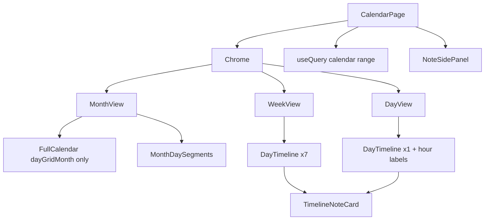

# Calendar view design M17
_Exported on 11/2/2026 at 15:18:32 GMT+6 from Cursor (3.26.16)_

---

**User**

Это новый чат, контекста прошлых нет. Прочитай: spec.md, STATUS.md,
docs/DECISIONS.md, docs/FRONTEND.md (§6, календарь), .cursor/rules/,
git log -25. M14 и M16 выполнены. Работаем над M17: вид календаря при
большом количестве заметок. Следуй .cursor/rules/00-process.mdc. Сначала
план в 10 строк, затем без вопросов.

Решение автора: месяц показывается точками и числом, неделя и день
компактными карточками. Иллюстрации и пилюли тегов в этих видах не
показываются, они остаются в списке, «Ближайшем» и панели заметки.

1. Месяц. В ячейке дня: число заметок (счётчик) и ряд цветных точек, по
   одной на каждый различный цвет тега среди заметок дня (используй теги
   текущего пользователя, включая персональные теги общих заметок из M16);
   заметки без тегов дают одну нейтральную серую точку. Показывается не
   больше 6 точек, остальные как «+N». У ячейки aria-label вида «7 заметок:
   work, sport…». Клик по ячейке открывает вид «День» этой даты (решение
   по умолчанию, запиши в DECISIONS.md). Ячейка одной высоты у всех дней,
   без роста от числа заметок, цель нажатия не меньше 44px.
2. Неделя и день. Компактная карточка: цветная полоска слева (цвет первого
   тега), время и название в одну строку с обрезкой; тег, иллюстрация и
   текст остаются в панели заметки по клику; подсказка с полным названием по
   наведению. Заметки без конца показываются как 30 минут (визуально,
   на сохранённое время не влияет), а не двухчасовыми столбцами.
3. Пересечения. Заметки в одном временном слоте располагаются рядом в
   равные колонки, но не больше 4 в слоте; остальные сворачиваются в
   карточку «+N ещё», по клику открывается список всех заметок слота с
   открытием каждой. Ничего не обрезается границей ячейки и не уходит
   за её пределы, включая конец суток.
4. АУДИТ КЛАССА: проверь другие экраны, где может оказаться много
   элементов (Ближайшее, уведомления, Корзина, список общих заметок,
   выбор тегов) и приведи их к тому же правилу: ограничение видимого,
   «+N ещё», без обрезания и роста за границы. Таблица находок в
   DECISIONS.md, исправь найденное.
5. Обнови docs/FRONTEND.md §6 (календарь) и скриншоты в docs/design/screens/
   для 1440 и 390.

Тесты (Playwright): e2e_month_dots_and_count (8 заметок с тремя тегами в
один день: три точки и число 8), e2e_month_cell_opens_day,
e2e_week_compact_cards, e2e_slot_overflow_plus_n (10 заметок в одном слоте:
4 колонки и «+6 ещё», список открывается), e2e_no_clipped_events (ни одно
событие не выходит за границы ячейки). Коммиты на русском с префиксом
M17:, запись в DECISIONS.md сразу после решения, фактический вывод
make test и make e2e. Напомни про экспорт чата.


---

**Cursor**

Читаю спеку, статус, решения и фронтенд-доки, затем дам план M17.

## M17 — план (вид календаря при многих заметках)

1. **Решение:** месяц = счётчик + точки; неделя/день = компактные карточки без иллюстраций/пилюль; клик по ячейке месяца → вид «День» этой даты — сразу в `DECISIONS.md`.
2. **Месяц:** фиксированная высота ячейки (≥44px), счётчик, ≤6 цветных точек (+ нейтральная серая без тегов), «+N», `aria-label` «N заметок: tag…».
3. **Неделя/день:** полоска цвета первого тега + время+название в одну строку с обрезкой и `title`; без тегов/иллюстраций в сетке.
4. **Длительность:** заметки без `ends_at` визуально 30 мин (не 2ч), сохранённое время не трогаем.
5. **Пересечения:** до 4 колонок в слоте, остальное «+N ещё» → список всех; без клипа за границы ячейки/суток (учёт D-041/D-088).
6. **Аудит класса:** Ближайшее, уведомления, Корзина, список общих, выбор тегов — таблица в DECISIONS + фикс overflow/`+N`.
7. **Доки/скрины:** `docs/FRONTEND.md` §6 календарь; скрины 1440 и 390.
8. **E2E:** `e2e_month_dots_and_count`, `e2e_month_cell_opens_day`, `e2e_week_compact_cards`, `e2e_slot_overflow_plus_n`, `e2e_no_clipped_events`.
9. **Коммиты** мелкие `M17: …` на русском; в конце `make test` + `make e2e` с фактическим выводом, `STATUS.md`.
10. **Готово:** 5 e2e зелёные, регрессии зелёные, DECISIONS+FRONTEND+скрины обновлены, без API/схемы.

Жду «ок».

---

**User**

Корректировка требований M17. Не приступать к реализации старого плана.

Предыдущий план неверно интерпретирует мои требования. Нужны следующие изменения.

1. Месяц: сохранить пилюли заметок и добавить переключение главной заметки

Не заменять существующие пилюли точками или счётчиками.

* Сохранить нынешнее отображение заметок в ячейках месяца.
* Если в один день несколько заметок, под основной видимой пилюлей разместить цветную горизонтальную полосу-сегмент (условно «колбаску»), состоящую из цветных сегментов соответствующих заметок.
* Каждый сегмент соответствует отдельной заметке и использует её цвет.
* По умолчанию главной отображается самая первая созданная заметка этого дня.
* При клике на сегмент соответствующая заметка становится главной в ячейке, а в правой боковой панели одновременно открывается эта заметка.
* Ячейка сохраняет обе функции: переключение главной заметки и открытие заметки в боковой панели.
* Переключение не должно менять порядок создания заметок или сохранять выбранную заметку как новую главную по умолчанию.

Продумать отображение большого количества заметок: сегменты не должны выходить за границы ячейки. Если заметок много, использовать компактное представление с доступом ко всем заметкам.

2. Неделя: полностью новый интерфейс

Не использовать прежний вид календаря с привычными временными колонками и крупными блоками.

Ориентир — современный минималистичный календарь-планировщик в стиле TickTick.

Визуальная концепция:

* Светлая тема, чистый современный интерфейс, много свободного пространства.
* Основное представление — вертикальный список дней недели: например, 5 Tue, 6 Wed.
* Каждый день имеет собственную вертикальную временную шкалу.
* На шкале расположены точки, соединённые вертикальной линией, формирующие визуальный таймлайн заметок.
* Рядом с точками располагаются компактные прямоугольные карточки заметок.
* Карточки содержат время и название заметки.
* Пастельные оттенки: нежно-розовый, голубой, мятный и другие цвета заметок.
* Закруглённые углы, аккуратная типографика, отсутствие визуального шума.
* В сетке отображаются только заметки, без иллюстраций и пилюль тегов.

Важно: это не косметическая переделка старого недельного календаря. Нужно создать новое представление с вертикальными днями и таймлайном.

3. День: тот же визуальный язык, что и у недели

Дневной календарь должен быть продолжением нового недельного дизайна.

* Одна вертикальная временная шкала на весь день.
* Слева или рядом с ней отображаются часы.
* Заметки располагаются вдоль временной шкалы в виде цветных карточек.
* Точки соединяются вертикальной линией, создавая непрерывный таймлайн.
* Никаких заголовков других дней недели.
* Сохранить тот же стиль карточек, типографики, цветов и отступов, что и в недельном представлении.

4. Общие требования

* Все три представления должны выглядеть как части одного современного приложения, но иметь разную логику отображения.
* Не ломать существующее открытие заметок в правой боковой панели.
* Учитывать большое количество заметок, пересечения и границы суток.
* Адаптивность для 1440px и 390px.
* Перед реализацией изучить текущую архитектуру календаря и предложить новую структуру компонентов, не пытаясь сохранить старую визуальную реализацию любой ценой.
* Обновить скриншоты и документацию после реализации.

Сначала пересмотри план M17 с учётом этих требований. Не начинай реализацию по предыдущему плану.

---

**Cursor**

Изучаю текущую архитектуру календаря, затем пересмотрю план M17 без реализации.

Архитектура ясна: сейчас всё на FullCalendar в одном `CalendarPage.tsx`. Готовлю пересмотренный план — месяц остаётся на FC с доработкой ячейки, неделя/день — новый таймлайн.

---
name: M17 calendar redesign
overview: "Пересмотренный M17: месяц — одна главная пилюля + сегмент-«колбаска» (без точек/счётчиков); неделя и день — новый TickTick-подобный вертикальный таймлайн вне FullCalendar; API/схема без изменений."
todos:
  - id: decisions
    content: "D-xxx: FC только month; week/day свой таймлайн; DnD trash только month; session main pill"
    status: completed
  - id: shell
    content: "Разбить CalendarPage: chrome + переключение видов + shared selection/range"
    status: completed
  - id: month
    content: "Month: одна главная пилюля + MonthDaySegments (+N popover при >8)"
    status: completed
  - id: timeline
    content: DayTimeline + TimelineNoteCard + layout коллизий/суток
    status: completed
  - id: week-day
    content: WeekTimeline (7 дней) и Day view на том же языке; 1440/390
    status: completed
  - id: e2e-docs
    content: 5 e2e + адаптация старых FC-тестов; FRONTEND §6/§7; скрины; STATUS; make test/e2e
    status: completed
isProject: false
---

# M17 · Календарь: месяц с переключением + таймлайн неделя/день

## Что отменяется из старого плана

- Точки/счётчики в месяце, «клик по ячейке → День», компактные FC-карточки week/day, «+N ещё» в слотах FC, аудит «класса» вне календаря.
- Косметика поверх `timeGridWeek` / `timeGridDay` — **не делаем**.

## Текущее состояние (якорь)

- Всё в [`web/src/pages/CalendarPage.tsx`](web/src/pages/CalendarPage.tsx): FullCalendar + luxon, `eventContent` с иллюстрацией/`TagPill`, DnD + trash-zone, `NoteSidePanel`.
- Данные: `GET /calendar` → `Occurrence[]`; у `NoteOut` уже есть `created_at` (для «первой созданной»).
- Инварианты времени (UTC / TZ / Clock) не трогаем; позиция на шкале — wall-time в `user.timezone` (как D-049).

## Архитектурное решение



| Вид | Движок | Поведение |
|---|---|---|
| Месяц | FullCalendar `dayGridMonth` | Одна главная пилюля (стиль как сейчас) + «колбаска» сегментов |
| Неделя | Свой React | Вертикальный список дней + таймлайн (точки + линия + карточки) |
| День | Тот же таймлайн | Одна шкала + подписи часов |

**По умолчанию:** desktop стартует с **Неделя**; mobile (≤640) — **День** (как D-081). DnD в корзину — **только в месяце** (FC); в week/day — «В корзину» из панели (как mobile сейчас). Решение сразу в `DECISIONS.md`.

## Структура компонентов (новые файлы)

Под [`web/src/components/calendar/`](web/src/components/calendar/):

- `CalendarChrome` — prev/next/today + Месяц|Неделя|День (desktop toolbar + mobile chrome).
- `MonthCalendar` — обёртка FC только month; кастомный `eventContent` / day cell hooks.
- `MonthDaySegments` — «колбаска»: равные сегменты по цвету первого тега заметки (`tagColors`); клик → session `mainOccKey` + `setSelected`.
- `DayTimeline` — общая шкала: вертикальная линия, точки по `starts_at`, карточки справа.
- `TimelineNoteCard` — время + название, пастельная заливка, без иллюстрации/TagPill; клик → панель.
- `groupByLocalDay.ts` / `timelineLayout.ts` — группировка по дню в TZ; сортировка; коллизии.

[`CalendarPage.tsx`](web/src/pages/CalendarPage.tsx) становится оболочкой: range/query, `selected`, trash undo, scope dialog, переключение вида; без монолитного `renderEventContent` для week/day.

## 1. Месяц

- В ячейке **одна** главная пилюля (не все события стопкой): default = min(`created_at`), tie-break `id`.
- Session-map `Record<dayKey, occKey>` — переключение **не** пишется в БД и сбрасывается при уходе с дня/reload.
- Под пилюлей — `MonthDaySegments`: сегмент на каждую заметку дня, цвет = первый тег (без тега — нейтральный).
- Клик по сегменту = сделать главной **и** открыть `NoteSidePanel` (та же `selected`).
- Клик по главной пилюле — по-прежнему открытие панели (как `eventClick`).
- Плотность: при >8 заметок — 7 сегментов + чип `+N`; чип открывает popover со списком всех заметок дня (клик строки = main + панель). Сегменты `flex` внутри ячейки, без выхода за границы; высота ячейки стабильная (FC `dayMaxEvents={1}` или скрытие non-main через `eventDidMount`/filter).

## 2–3. Неделя и день (TickTick-таймлайн)

- **Неделя:** колонки/блоки дней вертикально (`5 Tue`-стиль: число + weekday); у каждого дня свой `DayTimeline`.
- **День:** один `DayTimeline` на всю высоту + ось часов слева; без заголовков соседних дней.
- Карточка: пастель (`tagColors` fill), скругление из токенов, время `formatTimeHm` + title truncate; без иллюстраций и пилюль тегов в сетке.
- Точки на линии по времени; близкие по времени карточки стекаются с min-gap, не режутся границей суток (конец дня — clamp визуала, как дух D-088).
- Одинаковое время / плотный день: видимы до 4 карточек в кластере, далее `+N ещё` → список → открытие в панели.
- 1440: неделя — дни в ряд или комфортный horizontal scroll внутри main; 390: дни недели **стопкой** вертикально, день — одна шкала на весь экран; sheet-панель без изменений.

## 4. Общее / регрессии

- Не ломать `NoteSidePanel`, series scope, timezone, WS invalidate календаря.
- Обновить e2e, завязанные на `.fc-timegrid` / week slot layout (`e2e_week_many_notes_in_slot`, `e2e_calendar_slot_matches_label_timezone`, части m13/m15): селекторы → timeline/`data-testid`.
- DnD trash e2e — только month (или skip week path).
- `docs/FRONTEND.md` §6 календарь + §7 (D-041 slot overlap больше не про week/day).
- Скрины `docs/design/screens/calendar-{1440,390}.png` (и week/day при необходимости).
- API/миграции **не** меняем.

## Тесты (Playwright), имена под новый UX

- `e2e_month_main_pill_and_segments` — несколько заметок в день: одна главная пилюля + сегменты по числу заметок.
- `e2e_month_segment_switches_main_and_opens_panel` — клик сегмента меняет главную и открывает панель; после reload снова первая по `created_at`.
- `e2e_week_timeline_layout` — вертикальные дни, карточки время+название, нет `.fc-timegrid` / нет иллюстраций в сетке.
- `e2e_day_timeline_hours` — одна шкала, подписи часов, тот же язык карточек.
- `e2e_timeline_overflow_plus_n` — плотный кластер → `+N ещё` → список открывает заметку.

Плюс зелёный полный `make test` / `make e2e`.

## Коммиты / процесс

Мелкие коммиты `M17: …` (RU): DECISIONS → shell/chrome → month segments → timeline shared → week/day → e2e → FRONTEND/скрины/STATUS. В конце фактический вывод команд; напомнить экспорт чата в `docs/sessions/`.

## Критерий «готово»

Три вида визуально едины, но разная логика; месяц с пилюлей+колбаской; week/day — новый таймлайн; панель работает; 5 новых e2e + регрессии зелёные; DECISIONS + FRONTEND + скрины 1440/390 обновлены.
---

**User**

Implement the plan as specified, it is attached for your reference. Do NOT edit the plan file itself.

To-do's from the plan have already been created. Do not create them again. Mark them as in_progress as you work, starting with the first one. Don't stop until you have completed all the to-dos.

---

**Cursor**

Начинаю M17 с записи в DECISIONS, затем разберу календарь на shell + месяц + таймлайн.

Пишу DECISIONS и базовые утилиты/компоненты календаря.

Пишу оболочку `CalendarPage` и стили.

Передаю `initialDate` в месяц и обновляю список тестов в FRONTEND.

Исправляю проверки панели (title в input) и видимость карточек таймлайна.

## M17 готов

Месяц: одна главная пилюля + «колбаска» сегментов (session-only). Неделя/день: свой TickTick-таймлайн вне FullCalendar (D-098).

### Коммиты
```
6ae8945 M17: STATUS, скрины 1440/390 и правки e2e панели
06af7ff M17: e2e таймлайна/месяца и FRONTEND §6–§7
f795fa2 M17: shell календаря, месяц с сегментами и таймлайн week/day
7f41e3a M17: D-098 — месяц с колбаской; week/day таймлайн вне FC
```

### Тесты (факт)
```
make test  → 97 passed in 25.05s
make e2e   → 93 passed (2.5m)
```
В т.ч. `e2e_month_main_pill_and_segments`, `e2e_month_segment_switches_main_and_opens_panel`, `e2e_week_timeline_layout`, `e2e_day_timeline_hours`, `e2e_timeline_overflow_plus_n`.

### Артефакты
- `docs/DECISIONS.md` D-098, `docs/FRONTEND.md` §6–§7, `STATUS.md`
- Скрины: `calendar-1440.png`, `calendar-390.png`, `calendar-month-1440.png`, `calendar-day-1440.png`

Экспорт чата в `docs/sessions/`.

---

**User**

нет. неделю сделай как на скриншоте, в точности!

---

**Cursor**

Сверяю скриншот с текущим week-таймлайном и приведу вёрстку один в один.

Переделываю неделю под скриншот: вертикальный список дней, время у точек, полые кружки, карточки с интервалом и названием.

Неделя теперь как на референсе (D-099).

- Вертикальный список дней: крупное число + `Mon`/`Tue`…
- У каждой заметки: `HH:MM` → полый кружок на линии → карточка с интервалом `HH:MM–HH:MM` (+30 мин визуально) и названием
- Пастельный фон, цветная полоска слева, без иллюстраций и тегов в сетке
- День на том же языке

`make test` → 97 passed · `make e2e` → 93 passed  
Референс: `docs/design/week-agenda-reference.jpg`

---

**User**

День: пусть в дне по дефолту будет линия 24 часа и кружки, при добавлении заметок линия чуть удлинняется потому что там заметка, сделай пилюли заметок чуть шире по вертикали и у недели линии и кружки по дефолту

---

**Cursor**

Смотрю текущий agenda-день/неделю и скрин — сделаю 24ч-линию с кружками по умолчанию и более высокие пилюли.

Делаю для дня шкалу 24ч с кружками (заметки удлиняют линию), для недели — линию и кружки даже в пустых днях; пилюли выше.

Сделано (D-100):

**День** — по умолчанию линия на 24 часа с кружком на каждом часе; заметка заменяет тик своего часа и делает ряд выше → линия удлиняется. Пилюли `min-height: 72px`.

**Неделя** — у каждого дня линия и кружки сразу (компактный spine 06/09/12/15/18/21, если заметок нет).

`make test` → 97 · `make e2e` → 93

