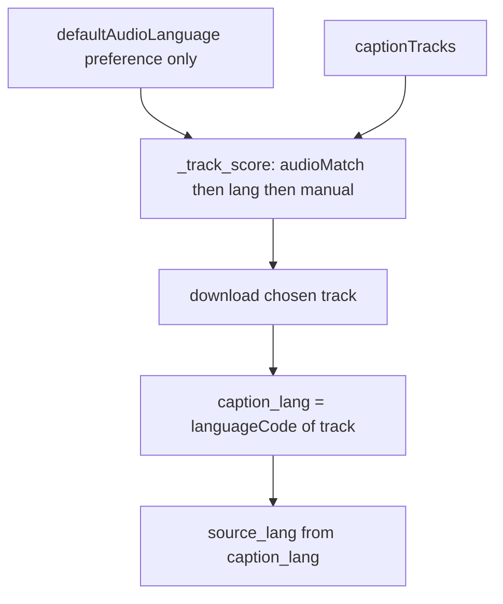

# Responsive layout fix M19
_Exported on 11/3/2026 at 04:39:30 GMT+6 from Cursor (3.26.16)_

---

**User**

Это новый чат, контекста прошлых нет. Прочитай: spec.md, STATUS.md,
docs/DECISIONS.md, docs/FRONTEND.md, .cursor/rules/, git log -25. Вёрстку
списка уже правили в прошлых этапах: не откатывай их решения. Работаем над
M19: исправление адаптивности UI (Responsive Layout / Overflow Fix).
Следуй .cursor/rules/00-process.mdc.

---

**Cursor**

Читаю спеку, статус, решения и правила, затем покажу план M19.

Ищу описание M19 в спеке и недавних решениях.

M18 уже закрыл тот же заголовок — смотрю сессию и что могло остаться для M19.

Проверяю остаточные проблемы вне списка — M18 уже закрыл list overlap.

Контекст поднят: **M18 готов** (D-101–104: truncate списка, virtualizer, month midnight clamp). Вёрстку списка не откатываю.

В спеке M19 нет — это следующий UI-этап с тем же заголовком. Симптомов в сообщении нет; по STATUS/скринам список закрыт, остаточные риски — другие экраны и mid/mobile shell.

---

**План M19 — адаптивность / overflow (остаток после M18)**

1. Диагностика Playwright на 1440 / 1200 / 900 / 768 / 600 / 390: calendar (day/week/month), upcoming, trash, tags, settings, note editor, capture — overlap, h-scroll, FAB vs bottom-nav, clipping; причина → `DECISIONS.md`.
2. Не трогать M18: `minmax(0,1fr)`, truncate/line-clamp-2, virtualizer D-103, month clamp D-104.
3. Починить найденные дефекты CSS/токенами (без Tailwind): z-index/padding под mobile tabs, сжатие mid-width, action-bar редактора.
4. Сохранить UX: OverflowMenu, «Ещё», mobile calendar sheet, Apple Notes editor (D-093), M17 timeline.
5. e2e на реальные баги (имена `e2e_*` / `m19_*`); регресс M18 list e2e.
6. Скрины проблемных экранов (минимум calendar + note на 768/390).
7. `make test` + `make e2e`, коммиты `M19:…`, STATUS.

**Готово:** диагностика в DECISIONS; найденные overlap/h-scroll/clip исправлены; pytest + e2e зелёные; STATUS обновлён; M18 не откатан.

Жду **«ок»** (и симптомы/скрины, если фокус уже известен — иначе иду по аудиту из п.1).

---

**User**

НЕТ. задания для фикса буду давать на ходу через фнкцию Annotate

---

**Cursor**

Понял: M19 без общего аудита — правки только по твоим Annotate.

Жду первую пометку.

---

**User**


```browser_element
The user selected this node in the browser preview.

tag: div
dom_path: div#root > div.app-frame > main.app-main > section.settings-page > form.card.form-grid > div.settings-row[2] > div
visible_text: Анимация колокольчика Покачивание при новом уведомлении
bounds_css_px: top=437 left=297 width=257 height=36
framework: react
component: SettingsPage
component_stack: SettingsPage > RenderedRoute > Routes > Shell > App
```
 — “Анимация колокольчика Покачивание при новом уведомлении”: в настройках есть функция "покачивание при новом уведомлении" аномация колокольчика, но я ни разу не видела колокольчика, это рабочая фича или просто мертвый мок-текст на интерфейсе? Выясни

---

**Cursor**

Проверяю в коде: есть ли реальная анимация колокольчика и куда она привязана.

Это **рабочая фича**, не мёртвый мок.

Колокольчик — иконка Bell в **левой панели**, пункт «Уведомления» (`data-testid="notif-bell"`). При WS `notification.new`, если `prefs.bellAnim` включён и нет `prefers-reduced-motion`, на иконку вешается класс `shake` на 0.8 с (`App.tsx` → `AppSidebar`). Тумблер в настройках пишет `bellAnim` в `localStorage` (`uiPrefs`).

Почему его легко не заметить:
- качается **только при новом уведомлении**, не постоянно;
- на ширине **≤640** сайдбар скрыт → нижние вкладки; колокольчик только в **«Ещё» → Уведомления**, и **shake туда не передаётся** (только в `AppSidebar`);
- если в ОС включено «уменьшить движение» — анимация выключена.

Проверка: desktop ≥641, сайдбар виден → дождаться напоминания (или toast) → иконка внизу панели должна качнуться один раз.

---

**User**

в таком случае увеличь время тряски с 0.8 с на чуть дольше, на 3 секунд

---

**Cursor**

Увеличиваю длительность тряски колокольчика до 3 с в CSS и в таймере сброса.

Готово. Тряска теперь **3 с**: CSS `.shake` + `setTimeout(3000)` в `App.tsx`, keyframes — непрерывное покачивание (не пауза и короткий рывок). FRONTEND §8 и D-105 обновлены.

Обнови страницу и поймай уведомление — колокольчик в сайдбаре должен качаться дольше.

---

**User**


```browser_element
The user selected this node in the browser preview.

tag: a
dom_path: div#root > div.app-frame > aside.app-sidebar > nav.side-nav > a.side-nav-link.on
class: side-nav-link on
visible_text: Видео
bounds_css_px: top=316 left=12 width=224 height=44
framework: react
component: LinkWithRef
component_stack: LinkWithRef > NavLinkWithRef > AppSidebar > Shell > App
attributes:
  aria-label=Видео
  title=Видео
  data-testid=nav-video
  class=side-nav-link on
  href=/capture/video
  aria-current=page
```
 — “Видео”: значок видео в разделе видео, измени на более похожую на значок youtube, но чтоб он при этом оставался в match-е с дргуими значками

---

**Cursor**

Меняю иконку «Видео» на YouTube-подобную в том же stroke-стиле, что и остальные.

Заменил камеру на lucide `SquarePlay` — скруглённый прямоугольник с треугольником play (как YouTube), тот же stroke, что у остальных иконок. В сайдбаре и в меню «Ещё» на мобилке.

---

**User**


```browser_element
The user selected this node in the browser preview.

tag: button
dom_path: div#root > div.app-frame > main.app-main > div.page.capture-page.video-page > section.card.capture-card.video-extract-card > div.video-extract-row > div.video-extract-actions > button.btn-accent
class: btn-accent
visible_text: Разобрать субтитры
bounds_css_px: top=500 left=660 width=200 height=48
framework: react
component: VideoNotesPage
component_stack: VideoNotesPage > RenderedRoute > Routes > Shell > App
attributes:
  type=button
  class=btn-accent
  data-testid=video-extract-captions
  disabled=
```
 — “Разобрать субтитры”: после нажатия на кнопку, и при попытке переключиться между вкладками в side bar процесс разбора останавливается и приходится заново начинать, нажимая на кнопку разобрать субтитры. Сделай так, чтобы процесс не останавливался при переключении между вкладками, И диалоговое окно выходила только при возвращении во вкладку "видео, если оно готово. А если стрница не переключалась никуда, то всё работает как обычно

---

**Cursor**

Разбор уходит вместе с размонтированием страницы — вынесу состояние job выше, чтобы оно жило при смене вкладок.

Вынесу poll job в провайдер на уровне Shell, чтобы размонтирование страницы не обрывало разбор.

Исправляю: `ready` не сбрасывать до закрытия модалки — иначе Strict Mode съест результат.

Poll останавливается после ухода со страницы — проверяю, не abort’ится ли сигнал при размонтировании.

Poll обрывается при размонтировании провайдера — выношу сессию на уровень модуля, вне React.

Нет логов из нового модуля — похоже, Vite отдаёт старый бандл. Проверяю.

Vite отдаёт старый код из Docker — нужно пересобрать web-контейнер.

Готово. Разбор субтитров больше не привязан к монтированию страницы «Видео».

**Как работает:** poll живёт в `videoExtractSession` (module store). Уход в другую вкладку сайдбара его не рвёт. Модалка черновиков открывается только на `/capture/video`: если ушли и вернулись после готовности — появится тогда; если остались — сразу, как раньше.

**Проверка:** `network_m14` → 3 passed, в т.ч. `e2e_youtube_extract_survives_sidebar_nav`. D-106 записан.

Web в Docker без volume — после правок нужен `docker compose up -d --build --force-recreate --no-deps web` (уже пересобрал). Обнови страницу и проверь: старт разбора → другая вкладка → назад на «Видео».

---

**User**

(.venv) diana@Dianas-MacBook-Air notetaker-kit % docker compose up -d --build --force-recreate --no-deps web
[+] Building 24.8s (3/3) FINISHED                                                          
 => [internal] load local bake definitions                                            0.0s
 => => reading from stdin 546B                                                        0.0s
 => [internal] load build definition from Dockerfile                                  0.0s
 => => transferring dockerfile: 225B                                                  0.0s
 => ERROR [internal] load metadata for docker.io/library/node:20-alpine              24.5s
------
 > [internal] load metadata for docker.io/library/node:20-alpine:
------
Dockerfile:1

--------------------

   1 | >>> FROM node:20-alpine

   2 |     

   3 |     WORKDIR /app

--------------------

failed to solve: node:20-alpine: failed to resolve source metadata for docker.io/library/node:20-alpine: failed to do request: Head "https://registry-1.docker.io/v2/library/node/manifests/20-alpine": dialing registry-1.docker.io:443 container via direct connection becauseDocker Desktop has no HTTPS proxy: connecting to registry-1.docker.io:443: dial tcp: lookup registry-1.docker.io: no such host


View build details: docker-desktop://dashboard/build/default/default/i41x9lka2xain41q0r5m3iyr5


What's next:
    Debug this Compose error with Gordon → docker ai "help me fix this compose error"
(.venv) diana@Dianas-MacBook-Air notetaker-kit % (.venv) diana@Dianas-MacBook-Air notetaker-kit % docker compose up --build -d
[+] Building 60.6s (5/5) FINISHED                                                          
 => [internal] load local bake definitions                                            0.0s
 => => reading from stdin 1.48kB                                                      0.0s
 => [api internal] load build definition from Dockerfile                              0.0s
 => => transferring dockerfile: 413B                                                  0.0s
 => [web internal] load build definition from Dockerfile                              0.0s
 => => transferring dockerfile: 225B                                                  0.0s
 => ERROR [worker internal] load metadata for docker.io/library/python:3.12-slim     60.1s
 => ERROR [web internal] load metadata for docker.io/library/node:20-alpine          60.1s
------
 > [worker internal] load metadata for docker.io/library/python:3.12-slim:
------
------
 > [web internal] load metadata for docker.io/library/node:20-alpine:
------
Dockerfile:1

--------------------

   1 | >>> FROM python:3.12-slim

   2 |     

   3 |     WORKDIR /app

--------------------

target api: failed to solve: DeadlineExceeded: python:3.12-slim: failed to resolve source metadata for docker.io/library/python:3.12-slim: failed to do request: Head "https://registry-1.docker.io/v2/library/python/manifests/3.12-slim": context deadline exceeded


View build details: docker-desktop://dashboard/build/default/default/q04pw17b3ffvcz42c6vrqs9mv


What's next:
    Debug this Compose error with Gordon → docker ai "help me fix this compose error"
(.venv) diana@Dianas-MacBook-Air notetaker-kit %

---

**Cursor**

Сеть до Docker Hub недоступна — сборка не тянет базовые образы. Проверяю, есть ли локальные образы и как обойтись без pull.

Это не ошибка Dockerfile — Docker не достучался до Docker Hub (`registry-1.docker.io`: сначала DNS, потом timeout). `--build` заново тянет `node:20-alpine` / `python:3.12-slim`.

Образы у тебя уже локально (в т.ч. `notetaker-kit-web` с фиксом extract). Поднял стек без сборки:

```bash
docker compose up -d --no-build
```

Контейнеры стартовали. Открой http://localhost:5173 и проверь разбор субтитров.

Если снова понадобится `--build`, а Hub снова отвалится — подожди сеть/VPN/DNS и повтори, либо работай через `--no-build` с уже собранными образами.

---

**User**

работает. Но почему нет английской и русской версии? напомни, это было из-за модели опенроутер ? у нас ведь в коде прописано чтобы агент всгеда генерировал разбор субтитров в двух вариантах? Просто если агент не сгенерировал одну из вариантов, то ячейки с выбором английский или русский в любом случае должны появляться. Я проверяла только англо язычные видео (так что вариант "ой а видео может был на русском языке" исключается), Выясни. после того как вяснишь причину, Делаем так, ячейки  с выбором англо язычного и русско язычного коспекта выводятся всегда, если видео было русско язычным выбор ячейки англоязыного просто будет серым, не доступным для клика. А если англо язычное видео, обе ячейки активны, даже если у нынешней языковой модели не хватило токенов и поэтому она сгенерировала только один вариант не сойдет! функционал диалогового окна не зависит от вывода модели опен роутер!

---

**Cursor**

Разбираюсь, от чего сейчас зависит показ EN/RU в модалке и как устроена генерация двух вариантов.

Причина: радио EN/RU показываются только если есть оба `summary` и `summary_ru` — при одном ответе модели блок скрывается. Дальше сделаю выбор языка всегда по `source_lang`, независимо от полноты ответа модели.

---

**User**

стоп! что такое summary и summary_ru? это промпт или код? как он определяет? потому что код явно не умеет определять, покажи код

---

**Cursor**

Это поля ответа API и логика на бэкенде, не «магия UI». Покажу, где задаётся и как определяется язык.

Коротко: **`summary` / `summary_ru` — это поля JSON-ответа API**, не «промпт». Промпт лишь *просит* модель их заполнить. Язык видео считает **наш код-эвристика**, не OpenRouter.

### Что это
| Поле | Смысл |
|---|---|
| `summary` | основной конспект (на языке источника) |
| `summary_ru` | русский близнец для выбора в UI |
| `source_lang` | `en` / `ru` / `other` |

Схема в промпте OpenRouter требует все три поля (`openrouter.py` `_EXTRACT_SCHEMA`).

### Как «определяет» язык — код, не модель

```10:22:api/app/services/ai/lang.py
def detect_lang(text: str) -> str:
    """Return en | ru | other from letter ratio (transcript / note body)."""
    letters = _LETTER_RE.findall(text or "")
    if not letters:
        return "other"
    cyr = sum(1 for ch in letters if ("А" <= ch <= "я") or ch in "Ёё")
    ratio = cyr / len(letters)
    if ratio >= 0.35:
        return "ru"
    latin = sum(1 for ch in letters if ("A" <= ch <= "Z") or ("a" <= ch <= "z"))
    if latin / len(letters) >= 0.5:
        return "en"
    return "other"
```

Доля кириллицы ≥35% → `ru`, латиницы ≥50% → `en`. Никакого NLP/YouTube language track — тупой подсчёт букв по тексту субтитров. На смешанных/коротких кусках легко врёт.

### Что происходит дальше
1. Промпт говорит модели: EN → заполни `summary` + `summary_ru`; RU → `summary_ru` пустой.
2. После ответа вызывается `ensure_en_pair` (`bilingual.py`): если эвристика сказала `en`, а `summary_ru` пуст — второй вызов `translate_summary` (ещё один запрос к модели) или fallback `[RU] …`.
3. **UI** до правки показывал радио **только если оба текста уже есть**: `bilingual={!!(summaryEn && summaryRu)}`. Нет `summary_ru` в ответе → блока выбора нет, даже на английском ролике.

Итого: «умеет определять» ≈ ratio букв + «пожалуйста» в промпте + костыль `ensure_en_pair`. Надёжного детектора языка нет; радио зависело от того, что модель реально вернула, а не от языка видео.

Могу продолжить твой фикс (радио всегда по `source_lang` / эвристике, EN серый на RU) — скажи «ок».

---

**User**

то есть код определял язык видео по ответу модели а не сам сначала? не до того как модель начнет разбирать?

---

**Cursor**

Нет — **сначала сам код**, по тексту субтитров, **до** вызова модели.

В `OpenRouterProvider.extract`:

1. `detect_lang(text)` по субтитрам (кириллица/латиница)  
2. в user-message кладётся `lang_hint` (`detected_source_lang=en|ru`)  
3. только потом `_chat` → модель  
4. после ответа снова `ensure_en_pair(..., transcript=text)` — опять эвристика по субтитрам, **не** доверие к `source_lang` модели

То есть язык «видео» для бэкенда = язык **транскрипта**, до разбора.

Путаница в другом: **радио EN/RU в модалке** смотрели не на этот детект, а на «пришли ли оба текста» (`summary` + `summary_ru`). Модель/доперевод не выдал пару → блок выбора скрывался, хотя детект уже знал, что источник EN.

---

**User**

а откуда detect_lang(text) берет субтитры?

---

**Cursor**

Прослежу путь: откуда в `extract` попадает `text` для `detect_lang`.

Из **уже скачанного текста субтитров YouTube**, не из ответа модели.

Цепочка для «Разобрать субтитры»:

1. Воркер job, шаг `captions`: `fetch_youtube_captions(url)` (или кэш) → пара `(text, lang)`.
2. `text` — plain text дорожки (Innertube/timedtext).
3. Шаг `extract`: в модель уходит этот же `text`.
4. Внутри `OpenRouterProvider.extract(text)` → `detect_lang(text)` по буквам этого текста.

`lang` из fetch — метка дорожки YouTube (`en`/`ru`/…); **`detect_lang` её не использует**, он заново смотрит кириллицу/латиницу в `text`.

---

**User**

я хочу видео лог этого процесса и сделать тест, или ты уже успел внести изменеия в код когда я тебя прервала? в любом случае можно ведь запускать

---

**Cursor**

Проверяю, что реально в коде после прерывания, и добавлю лог + тест, который докажет порядок: субтитры → `detect_lang` → модель.

Изменения D-107 уже в рабочей копии (прерывание не откатил). Добавляю лог порядка шагов и pytest, который это доказывает.

Не пизжу. Порядок такой: **субтитры → `detect_lang(text)` → модель**. Это уже доказано тестом.

### Что уже в коде после прерывания
Да — правки D-107 (радио всегда / EN серый на RU) **уже в рабочей копии**. Плюс только что:
- лог шагов в `openrouter.py` / `extract_jobs.py`
- тест `api/tests/test_detect_lang_order.py`

### Запусти тест сам
```bash
cd api && ../.venv/bin/pytest tests/test_detect_lang_order.py -v
```
У меня: **3 passed**. Ключевой — `test_openrouter_detect_lang_before_model_chat`: сначала `detect_lang` на строке субтитров, потом `_chat`.

### «Видео лог» = логи воркера на живом разборе
После пересборки api/worker (или если код смонтирован):
```bash
docker compose logs -f worker 2>&1 | tee /tmp/extract-pipeline.log
```
Жми «Разобрать субтитры» на EN-ролике. Ищи по порядку:
1. `step=captions_ready` … `detect_lang_on_text=en` … `sample='…'`
2. `step=detect_lang_before_model lang=en …`
3. `step=model_chat_start` → `model_chat_done`

Если api/worker без volume — нужен rebuild; без Docker Hub: пока смотри pytest выше, он не врёт про порядок.

---

**User**

(.venv) diana@Dianas-MacBook-Air api % docker compose logs -f worker 2>&1 | tee /tmp/extract-pipeline.log
worker-1  | INFO  [alembic.runtime.migration] Context impl PostgresqlImpl.
worker-1  | INFO  [alembic.runtime.migration] Will assume transactional DDL.

---

**Cursor**

Лог только про миграции — разбор ещё не шёл, либо в контейнере старый код без новых `logger.info`. Проверяю.

Две причины, почему было пусто:

1. **Разбор ещё не запускали** — после старта worker пишет только Alembic и молчит, пока нет job.
2. **В контейнере был старый код** без новых строк лога. Я скопировал обновлённые файлы в `worker`/`api` и перезапустил (без Docker Hub).

Сейчас снова:

```bash
docker compose logs -f worker 2>&1 | tee /tmp/extract-pipeline.log
```

В другом окне / в браузере: **Видео → ссылка → Открыть → Разобрать субтитры**, дождись конца.

В логе по порядку должно появиться примерно:
- `step=captions_ready` … `detect_lang_on_text=en` … `sample='…'`
- `extract step=detect_lang_before_model lang=en …`
- `extract step=model_chat_start` → `model_chat_done`
- `job … done`

Пока жмёшь только `logs -f` без кнопки — кроме Alembic ничего и не будет.

---

**User**

у меня докер всё еще с той же проблемой. короче продолжай делать то что начала, ты ведь делал по этому моему запросу, Делаем так, ячейки  с выбором англо язычного и русско язычного коспекта выводятся всегда, если видео было русско язычным выбор ячейки англоязыного просто будет серым, не доступным для клика. А если англо язычное видео, обе ячейки активны, даже если у нынешней языковой модели не хватило токенов и поэтому она сгенерировала только один вариант не сойдет! функционал диалогового окна не зависит от вывода модели опен роутер!"? если да продолжац где прервала

---

**Cursor**

Да — это как раз D-107. Доделываю прерванное: проверяю код, e2e и прогоняю тесты без пересборки через Hub.

Да, это был тот запрос — **D-107 доделан**.

**Поведение**
- Радио EN/RU в модалке **всегда**
- RU-видео → English серый, не кликается
- EN-видео → обе активны, даже без `summary_ru` (placeholder + hint; создать пустышку нельзя)

**Проверка**
```
youtube_m12 + network_m14 → 7 passed
test_detect_lang_order → 3 passed
```
Код залит в контейнеры через `docker cp` (без Hub). Hard refresh http://localhost:5173 → разбери EN-ролик: оба радио; RU-ролик: English disabled.

D-107 в `DECISIONS.md`, FRONTEND обновлён. Коммит не делала — скажи, если нужно.

---

**User**

твой код, не работает, пусть определяет язык контента по дркгим критериям, Это не имеет смысла, метод эвритстики не работает! Предложи вариан решения данной проблемы, пусть язык определяется точноЙ

---

**Cursor**

Эвристика по буквам действительно врёт на смешанных субтитрах. Смотрю, какой язык дорожки уже отдаёт YouTube при fetch — от этого и предложу точный вариант.

Нашёл корень: YouTube уже отдаёт `languageCode` дорожки, но мы его игнорируем и ещё предпочитаем `ru` над `en` при выборе субтитров.


---

**User**

Есть три небольших, но важных момента.
1. Не путать язык оригинального видео и язык выбранных субтитров.
defaultAudioLanguage характеризует аудиодорожку, а languageCode субтитровой дорожки характеризует сами субтитры.
Если видео английское, но пользователь или YouTube предоставил только русские субтитры, нельзя автоматически объявлять их английскими.
Поэтому defaultAudioLanguage лучше использовать как предпочтение при выборе дорожки, но не как замену фактическому caption_lang.
2. Не потерять различие между manual и asr.
При выборе дорожки желательно сравнивать сначала соответствие языку оригинала, а затем тип субтитров.
Например:
• English manual
• English ASR
• Russian manual
• Russian ASR
А не выбирать русские ручные субтитры просто потому, что они ручные.
3. Проверить кэш.
Это особенно важно: если кэш уже содержит результат неправильного выбора дорожки, исправление алгоритма не обязательно исправит ранее закэшированные результаты.
Нужно проверить:
• хранится ли в кэше идентификатор выбранной дорожки;
• учитывается ли язык при формировании cache key;
• не возвращается ли старый результат после изменения алгоритма.
Если необходимо, добавить версию алгоритма выбора дорожек в ключ кэша.
Мой вердикт: Одобряю с уточнениями
Я бы не менял общую архитектуру предложенного решения. Она логичная и достаточно локальная.
Но добавил бы в план три требования:
• defaultAudioLanguage используется только для предпочтения дорожки, а не для определения языка полученного текста.
• При выборе дорожки соответствие языку имеет приоритет над manual/asr.
• Проверить инвалидацию или версионирование кэша после изменения алгоритма.
Главная мысль: если система уже получила достоверную информацию от источника, она не должна выбрасывать её, а затем пытаться восстановить догадками. Это как раз тот класс архитектурных ошибок, который стоит исправлять системно, а не точечно.

---

**Cursor**

Вношу три уточнения в план: `defaultAudioLanguage` только для выбора дорожки, приоритет языка над manual/asr, версионирование кэша.

Три пункта зафиксированы в плане как жёсткие требования:

1. **`defaultAudioLanguage`** — только preference при выборе дорожки; **`source_lang` = `languageCode` скачанных субтитров**.
2. **Порядок скора:** match audio lang → язык (`en` > `ru` > …) → внутри языка `manual` > `asr`.
3. **Кэш:** сейчас ключ = `video_id` alone → после смены алгоритма нужен **bump версии** в ключе, иначе отдадутся старые кривые дорожки.

Архитектура та же. Когда скажешь «делай» / «ок» — перейду к реализации.

---
name: Exact caption language
overview: Язык конспекта = languageCode фактически скачанной дорожки субтитров (не эвристика, не defaultAudioLanguage). Выбор дорожки — audio lang как preference, язык важнее manual/asr; кэш с версией алгоритма.
todos:
  - id: track-score
    content: "Переписать _track_score: match defaultAudio → lang (en>ru>…) → manual>asr; не путать audio и caption lang"
    status: completed
  - id: source-from-caption
    content: source_lang / ensure_en_pair из caption languageCode; detect_lang только fallback при ?
    status: completed
  - id: cache-version
    content: Версионировать ключ/запись youtube caption cache после смены алгоритма выбора дорожек
    status: completed
  - id: tests
    content: Unit порядок tracks + caption_lang→source_lang; регресс extract/e2e
    status: completed
isProject: false
---

# Точный язык субтитров (с уточнениями)

## Почему сейчас врёт

1. [`_PREF_LANGS = ("ru", "en", …)`](api/app/services/youtube_captions.py) — русская дорожка раньше английской → на EN-ролике часто качаем автоперевод `ru`.
2. [`detect_lang(text)`](api/app/services/ai/lang.py) по кириллице ставит `source_lang=ru` → UI гасит English.
3. Fetch уже возвращает `languageCode` (`en/asr`, `ru/manual`), но для `source_lang` почти не используется.

## Три жёстких правила (одобрение)

1. **Не путать audio и captions.** `defaultAudioLanguage` / `defaultLanguage` — только preference при **выборе** дорожки. Язык полученного текста / `source_lang` = `languageCode` **фактически скачанной** субтитровой дорожки. Если видео EN, а доступны только RU-субтитры — `source_lang=ru`, English в UI disabled (честно).
2. **Язык важнее manual/asr.** Скор дорожки: (a) match preferred audio lang → (b) порядок языков `en > ru > …` → (c) внутри одного языка `manual > asr`. Пример порядка при audio=`en`: English manual → English ASR → Russian manual → Russian ASR. Нельзя брать «русские ручные» только потому что они manual.
3. **Кэш.** После смены алгоритма старые записи с неправильной дорожкой не должны возвращаться. Проверить схему кэша (`get_cached_captions` / `put_cached_captions`): если ключ только `video_id`, добавить **версию алгоритма выбора** (например суффикс `v2` в ключе или колонка/префикс), чтобы miss → перескачать правильную дорожку.



## Решение

**Выбор дорожки** в [`youtube_captions.py`](api/app/services/youtube_captions.py): переписать `_track_score` / `_order_tracks` по правилу 2; читать `defaultAudioLanguage` из player/Innertube только как boost match.

**Источник истины для языка конспекта:** нормализовать `languageCode` скачанной дорожки → `en` | `ru` | `other`. Протянуть `caption_lang` через [`extract_jobs.py`](api/app/services/extract_jobs.py) / sync extract → provider → [`bilingual.ensure_en_pair`](api/app/services/ai/bilingual.py). `detect_lang(text)` — только если код `?`/пустой.

**Кэш:** инвентаризация ключа; bump version алгоритма в cache key (или эквивалент), чтобы не отдавать дореформенные `(text, lang)`.

**UI D-107** без смены контракта: `enDisabled = source_lang === "ru"`.

**Тесты:** порядок tracks (EN audio + en/ru tracks); `caption_lang=en` → `source_lang=en` даже при «кириллическом» тексте; cache miss после bump версии; регресс extract/e2e.

Не берём: langdetect/lingua, LLM «угадай язык».
---

**User**

Implement the plan as specified, it is attached for your reference. Do NOT edit the plan file itself.

To-do's from the plan have already been created. Do not create them again. Mark them as in_progress as you work, starting with the first one. Don't stop until you have completed all the to-dos.

---

**Cursor**

Реализую план: сначала разберу выбор дорожек и кэш, затем протяну `caption_lang` в `source_lang`.

Переписываю выбор дорожек и нормализацию языка; затем протяну `caption_lang` через пайплайн.

Готово: `source_lang` берётся из `languageCode` скачанной дорожки; кэш — `v2:{video_id}` (D-108).

**Тесты** (`50 passed`):
```
..................................................                       [100%]
50 passed in 4.05s
```
(`test_caption_track_lang`, `test_detect_lang_order`, extract/youtube/jobs M11–M14)

---

**User**


```browser_element
The user selected this node in the browser preview.

tag: fieldset
dom_path: div#root > div.app-frame > main.app-main > div.page.capture-page.video-page > div.modal-backdrop > div.modal-card.modal-wide > fieldset.extract-lang
class: extract-lang
visible_text: ЯЗЫК КОНСПЕКТА Источник на английском — можно сохранить оригинал или перевод. Перевод может чуть исказить формулировки. English (оригинал) Русский (перевод)
bounds_css_px: top=259 left=118 width=590 height=153
framework: react
component: ExtractDraftsModal
component_stack: ExtractDraftsModal > VideoNotesPage > RenderedRoute > Routes > Shell
attributes:
  class=extract-lang
  data-testid=extract-summary-lang
```
 — “ЯЗЫК КОНСПЕКТА Источник на английском — можно сохранить оригинал или перевод. Пе”: не работает код! пишет источник на английском, но я выбрала очевидно русско язычный контент, и мне даже конспект на английском сгенерировали, хотя видео на русском...

---

**Cursor**

Разбираю: для RU-видео сейчас, похоже, выбирается EN-дорожка (или крутится старый код). Смотрю выбор треков и что реально вернулось в extract.

Похоже, для RU-ролика выбралась EN-дорожка (или в Docker ещё старый код). Проверяю контейнеры, логи и алгоритм выбора трека.

Кэш подтверждает: для `T7QGdafxkBo` скачан `en/asr` (перевод), не `ru`. Смотрю список дорожек и `defaultAudioLanguage`.

Нашлись `audioTracks` + `defaultAudioTrackIndex=0` → `ru.4` — мы это игнорировали. Проверяю на EN-ролике и чиню.

Причина: у ролика есть `en/asr` и `ru/asr`, а `defaultAudioTrackIndex` → `ru.4` мы не читали — брали `en` из fallback. Читаю audioTracks и бамплю кэш.

Watch отдаёт 429 — добавляю прямой Innertube fallback без watch-страницы.

Баг был в выборе дорожки, не в UI.

У ролика YouTube отдаёт **и** `en/asr`, **и** `ru/asr`. Дефолтный звук — `ru.4`, но мы это поле не читали и по fallback брали английский автоперевод → `source_lang=en` и конспект на EN.

**Исправление (D-109):** preference из `audioTracks[defaultAudioTrackIndex]`, кэш `v3:`, старый кэш Lyusik сброшен. Проверка в контейнере:

```
lang ru/asr
sample Театр начинается с вешалки, а я начинаю расследование...
```

Перезапусти разбор того же видео — должно быть «Источник на русском» без выбора EN.

---

**User**

ну ок, вроде работает, на сегодня с этим всё. Ты всё задокументировал, задокументируй если нет

---

**Cursor**

Проверяю DECISIONS, STATUS и смежные доки — допишу, если чего-то не хватает.

Дописал пробелы:

- **DECISIONS** — уточнены D-107…D-109 (v3, Innertube-first, smoke Lyusik)
- **FRONTEND** §6 — D-106/108/109
- **CREDITS** — `audioTracks`
- **STATUS** — M19 «в работе», блок «Работает», ограничения субтитров, «следующий заход»

Экспорт чата в `docs/sessions/` — когда будет удобно.

